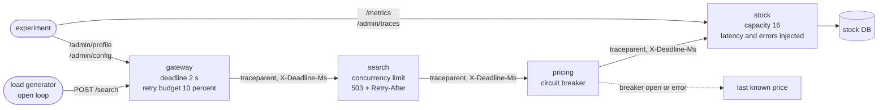

# Architecture

A chain of four small services, `gateway -> search -> pricing -> stock`, and an experiment harness that slows the bottom one down. The services run the same code under three resilience profiles that can be switched at runtime, so one set of containers produces the naive baseline and both fixes.

Pattern: **ports and adapters** inside each service (`domain`, `application`, `infrastructure`, `interfaces`) with the **resilience policy as a separate pure package** (`libs/resilience`) that the domain and application layers may import and the infrastructure code never decides. The layering fits because the lesson is about decisions (when to retry, when to refuse, when to stop calling), and decisions with a fake clock are unit tests, while their effects on a running chain are experiments.

## Components and what each owns

| Component | Owns | Does not own |
| --- | --- | --- |
| **gateway** (`services/gateway`) | the end-to-end deadline (2 seconds); the retry loop with backoff, jitter and the retry budget; the 503 with `Retry-After` | any call below search |
| **search** (`services/search`) | resolving a query to a sku; the concurrency limit and load shedding; the partial result when pricing cannot be asked | retries |
| **pricing** (`services/pricing`) | the price rule (base price, 15 percent surcharge under 10 units); the circuit breaker on the stock call; the last-known-price fallback | retries |
| **stock** (`services/stock`) | `stock_levels` in its own PostgreSQL database; finite capacity; the injected latency and failure rate | |
| **resilience** (`libs/resilience`) | `Deadline`, `Backoff`, `RetryBudget`, `CircuitBreaker`, `ConcurrencyLimiter`, the two retry loops, the profiles; no I/O | |
| **chassis** (`libs/chassis`) | settings, JSON logging, W3C trace context and spans, the deadline context, metrics, one-attempt upstream calls, health, the async PostgreSQL pool | any decision |
| **harness** (`tests/system`) | the open-loop load generator, metric scraping, trace rendering and the experiments | |

## Data flow

Drawn versions of this figure and of the walk-through: [the architecture](docs/diagrams/architecture.svg) and [one run](docs/diagrams/flow.svg).

One request under the full profile:

1. The gateway starts a trace, gives the request a 2 second deadline and calls search with a timeout of `min(1.8 s, remaining - 50 ms)`; the remaining milliseconds travel in `X-Deadline-Ms`.
2. Search resolves the query to a sku. If it already has `limit` requests in progress it answers 503 with `Retry-After: 1` at once. Otherwise it calls pricing once, with `min(1.2 s, remaining - 50 ms)`.
3. Pricing asks its circuit breaker. If the breaker is open it returns the last known price flagged `stale` without calling anyone. Otherwise it calls stock once, with `min(0.7 s, remaining - 50 ms)`, and records the outcome in the breaker.
4. Stock waits for capacity, sleeps for the injected latency, may fail, reads PostgreSQL, answers. If the request's deadline passes at any point, it stops and answers 504.
5. The answer returns up the chain. Pricing's fallback and search's partial result mean a slow bottom produces a degraded 200, not an error.
6. If search or pricing did fail, the gateway may retry: only if the error is retryable, the budget allows it, and the remaining time covers the pause and another attempt.

Under the naive profile every hop retries three times immediately with a 2 second timeout and no deadline header, which multiplies the calls at each layer.

## Decisions and trade-offs

Each of the first three has a record in [docs/adr](docs/adr).

| Decision | Why | Cost |
| --- | --- | --- |
| Policy as a package of plain objects, three runtime profiles (ADR 1) | the same code and data for every measurement; each rule is a unit test | the naive profile stays in the code |
| A capacity-limited stock store that finishes abandoned work unless a deadline was sent (ADR 2) | it is what makes a storm outlive its cause | numbers depend on the capacity and load parameters |
| Hand-rolled W3C trace context, in-memory spans, Prometheus counters (ADR 3) | no extra containers; a trace is one command | not exported; lost on restart |
| Retries only at the gateway, with exponential backoff and full jitter | amplification has nowhere to compound | a failure below the gateway is retried only once the request is back at the edge |
| A retry budget of 10 percent of requests in a 10 second window, at least 3 retries | caps the load that retries can add, however many requests fail | a short burst of failures beyond the budget is not retried |
| Per-hop timeouts 1.8 s, 1.2 s, 0.7 s inside a 2 s deadline, each also capped by what is left minus 50 ms | the timeouts nest; a hop never works past the deadline | the margin is a constant |
| The breaker opens at 50 percent failures over at least 10 calls in 10 seconds, stays open 5 seconds, then lets 3 probes through | fast to open, quick to test recovery | thresholds are guesses to tune per dependency |
| Load shedding with a plain counter, not a queue | a request over the limit is refused at once instead of waiting for a turn it cannot use | the limit is fixed (an adaptive limit is a stretch goal) |
| The open-loop load generator | a closed loop slows down when the system does, and hides the overload | more memory in the generator |
| Async services (FastAPI, httpx) | hundreds of requests in flight on one process, as the experiment needs | async code in the use cases |

## Failure modes the lesson teaches and where the code shows them

| Failure | Where it is in the code | How to see it |
| --- | --- | --- |
| Retries multiply across hops | `run_naive` at every hop under the `naive` profile | `make experiment-naive` |
| A slow bottom becomes an outage at the top; the load outlives the slowdown | `slowdown("naive")`, `CheckStock` without a deadline | `make experiment-storm` |
| Retries stop amplifying | `run_budgeted` at the gateway only; `Deadline` at every hop | `make experiment-policy` |
| A dead dependency still receives traffic | `CircuitBreaker` in `QuotePrice` | `make experiment-outage` |
| A queue that cannot be left in time | `ConcurrencyLimiter` in `SearchProducts` | `make experiment-shedding` |
| Everything together | the `full` profile | `make experiment-full` |

## Operability

- Structured logs: one JSON object per line on stderr with `ts`, `level`, `service`, `logger`, `msg` and `correlation_id`, which is the trace id. Request lines are written only for sampled traces and for 5xx answers, because a collapsed system serves thousands of requests per second.
- Health: `/health/live` and `/health/ready` on every service; stock's readiness follows a database check refreshed every two seconds.
- Graceful shutdown: uvicorn stops accepting requests on SIGTERM and finishes the ones in flight (10 second limit); lifespan handlers close the HTTP clients and the pool.
- Timeouts on every call: each attempt is bounded by `asyncio.timeout` (the whole call, not just each socket operation), PostgreSQL connections have connect, statement, lock and idle timeouts, and the chain's retries are only those described above. The one deliberate exception to "retries with backoff on every call" is the naive profile, which exists to be measured.

## Limits of the teaching build

- One container per service and one database server; no replicas, so load shedding and the breaker are per instance.
- The price cache is in the pricing process; a real fallback cache would be shared and bounded by business rules (how old a price may be).
- Traces are kept in memory and sampled; nothing is exported.
- The admin routes have no authentication and exist for the experiments.
- Numbers depend on the machine and on the parameters (load, capacity, latency); the README reports the shape and the run that produced them.
- Python's event loop is the limit of what one container can serve; the experiments stay well below it.

## How to extend it

- Put two clients on the same stock store and show a bulkhead keeping one healthy (the lesson's first stretch goal): a separate `ConcurrencyLimiter` per caller in `stock`.
- Replace the fixed search limit with an adaptive one (additive increase, multiplicative decrease on latency) and compare under a sudden doubling of load.
- Add hedged requests at the gateway for reads and show the effect on p99 and on total load.
- Export the spans through OpenTelemetry and look at the same trees in a trace viewer.
